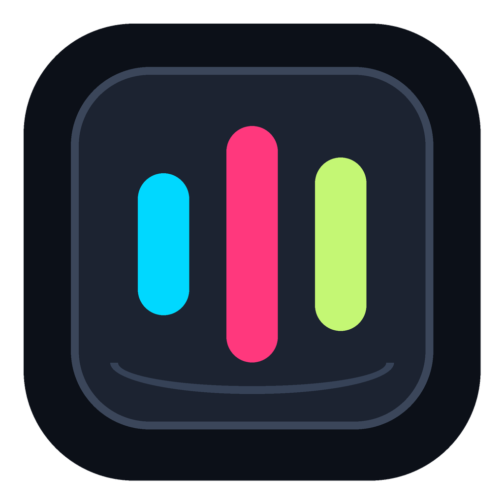

<p align="center"></p>
<h1 align="center">Keylume</h1>
<p align="center">Your keyboard. Your canvas.</p>
<p align="center"><a href="https://github.com/senrishi/MK1300RGB/actions/workflows/build.yml"></a> <a href="https://github.com/senrishi/MK1300RGB/releases/latest">Download the latest release</a> · <a href="https://mk1300-rgb-studio.earlyactor1.chatgpt.site">Open the web app</a></p>

Keylume is a per-key RGB editor for the **Ant Esports MK1300 V2 mechanical gaming keyboard**, a 61-key / 60% keyboard. The supported hardware is USB **VID `36AE`, PID `FE12`**, using its vendor configuration interface (`FF00:0002`). Other MK1300 revisions and keyboards with different IDs are not supported by these desktop drivers.

Paint individual keys, apply firmware animations, adjust brightness, explore 140 Kicktroll presets, or display the included static **RS monogram**. Other keys can be completely unlit.

## Downloads

Get the desktop apps from [GitHub Releases](https://github.com/senrishi/MK1300RGB/releases/latest):

| Download | Platform | Connection |
| --- | --- | --- |
| `Keylume-<version>-macOS-universal.zip` | macOS 13+, Apple Silicon and Intel | Native SwiftUI app with IOKit HID and menu bar controls |
| `Keylume-<version>-Windows-x64.exe` | Windows 10/11 x64 | Portable Electron app with native HID, offline editor, and system tray |
| `Keylume-<version>-Web.zip` | Desktop Chrome/Edge for device control | Static WebHID app; self-host over HTTPS |

On macOS, unzip and move **Keylume.app** into Applications. The bundle retains the original `local.mk1300.rgb` identifier, so existing macOS saved presets and brightness preferences remain available. Replace/remove the older `MK1300-RGB.app` when upgrading. Close the editor to keep its menu bar controls running; quit from the menu bar to exit.

On Windows, run the portable `.exe`; close the window to keep it in the tray, or choose **Quit Keylume** from the tray. Close the official keyboard software and other RGB controllers before connecting. Windows uses native HID, so it does not need a browser WebHID permission prompt.

Desktop downloads are not vendor-signed/notarized. macOS Gatekeeper or Windows SmartScreen may require the operating system's normal approval flow. `SHA256SUMS.txt` accompanies each release. Windows CI verifies executable packaging and native HID loading; physical keyboard operation on Windows still needs hardware validation.

## Features

- All 61 keys: select, paint, turn off, and scale static RGB brightness.
- 140 attributed Kicktroll presets plus the RS design across the top four rows.
- 14 hardware animations, including Bloom, Wave, Rain, Meteor, and reactive effects.
- Saved custom layouts; web and Windows JSON import/export for moving layouts between machines.
- Native macOS menu bar: brightness, saved presets, Apply, Lights Off, and reopen editor.
- Windows tray: reopen the editor or quit. The app works without a hosted website.
- Every lighting write requires a keyboard acknowledgment; firmware effects also verify mode, brightness, and speed readback.

There is no measured power readout: neither the inspected vendor protocol nor macOS exposed actual electrical telemetry. See [the investigation](docs/power-telemetry.md).

## Source layout

```text
apps/
  macos/       SwiftUI editor and native C HID probe
  windows/     Electron shell, isolated preload, and native HID bridge
  web/         Shared browser editor, WebHID driver, and static hosting files
shared/
  key-map.h    Verified physical key offsets
  presets/     RS monogram
  resources/   Kicktroll catalog, attribution, and license
branding/      SVG source, PNG logo, ICNS/ICO desktop icons, tray icon
scripts/       macOS build, preset import, icon generation
vendor/        Pinned upstream Kicktroll submodule
.github/       CI builds and release publishing
```

## Build from source

### macOS

Requires Xcode Command Line Tools and macOS 13+:

```sh
zsh scripts/build-macos.sh
# Build both architectures for a release:
KEYLUME_ARCHS="arm64 x86_64" zsh scripts/build-macos.sh
```

Output: `dist/Keylume.app`. The build signs it ad hoc and validates the keyboard layout, catalog, brightness, persistence format, and shared menu/editor commands without changing keyboard lighting.

### Windows

Requires Windows, Node.js 22+, and npm. Native build tools may be required if no prebuilt `node-hid` binary is available.

```sh
cd apps/windows
npm ci
npm test
npm run dist
```

Output: `apps/windows/dist/Keylume-<version>-Windows-x64.exe`. The renderer reuses the web editor; its isolated preload exposes only bounded RGB operations to the native HID bridge. Node integration is disabled. Packaging includes all UI assets and preset data.

### Web / homelab

```sh
cd apps/web
npm test
npm run build
python3 -m http.server 4173 --bind 127.0.0.1 --directory dist
```

For remote or LAN use, serve `apps/web/dist` over **HTTPS**. See [hosting and Docker instructions](apps/web/README.md). The keyboard must be connected to the computer running the browser, not the web server. Safari, Firefox, and mobile browsers can edit layouts but device control requires a supported desktop WebHID browser and access to the vendor RGB reports.

Custom web/Windows presets remain on the current machine in the app/browser's local storage. No preset account, session token, upload, or cloud sync is used. JSON export/import transfers presets; macOS retains its own existing native preset storage.

## Workflows and releases

[Build and test](.github/workflows/build.yml) runs on main pushes, pull requests, and manual dispatch. It tests the web/protocol layer, builds a universal macOS app and Windows executable, smoke-tests the packaged Windows app/native HID binding, and uploads artifacts.

[Publish release](.github/workflows/release.yml) runs on version tags. It repeats the checked builds, creates desktop and web downloads with SHA-256 checksums, and publishes a GitHub Release only after all jobs succeed. Update `VERSION` and `apps/windows/package.json` together, then push a matching tag, for example `v2.0.0`. Update [release notes](docs/release-notes.md) for each release.

## Protocol and credits

FE12 lighting writes must preserve the device's returned configuration type **1**; forcing type 0 causes silent timeouts. No firmware flashing or factory reset operations are exposed. The Windows bridge and web driver enforce RGB/config command allowlists.

The upstream [Kicktroll project](https://github.com/kicktroll/mk1300v2_RGB) is pinned under `vendor/mk1300v2_RGB`. Its preset catalog is bundled with [attribution](shared/resources/Kicktroll-Attribution.txt) and the [Apache-2.0 license](shared/resources/Kicktroll-LICENSE.txt). Refresh it with `git submodule update --init` followed by `node scripts/import-kicktroll.mjs`. The Keylume SVG logo and its generated app icons are under `branding/`; regenerate raster icons with `python3 scripts/generate-icons.py` (requires Pillow).
